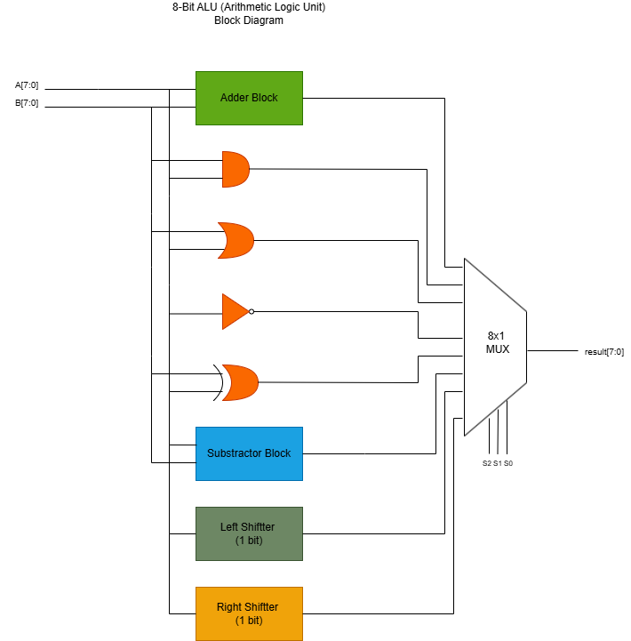
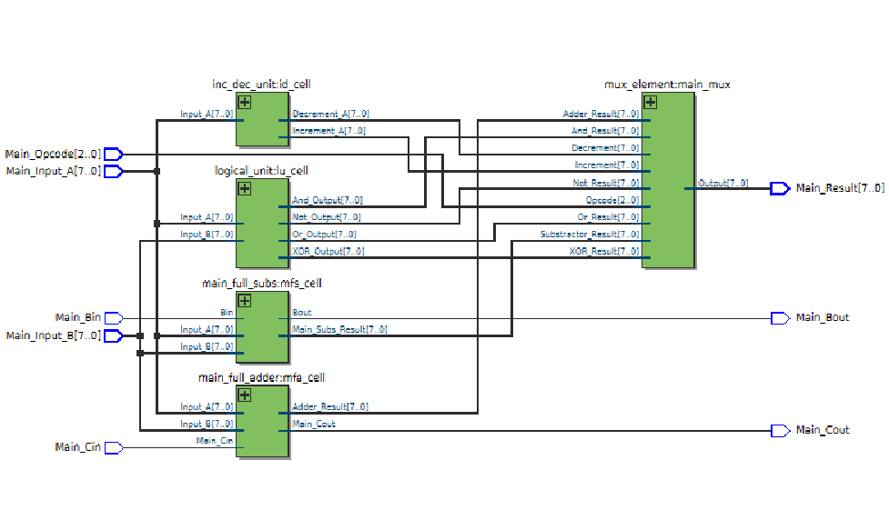
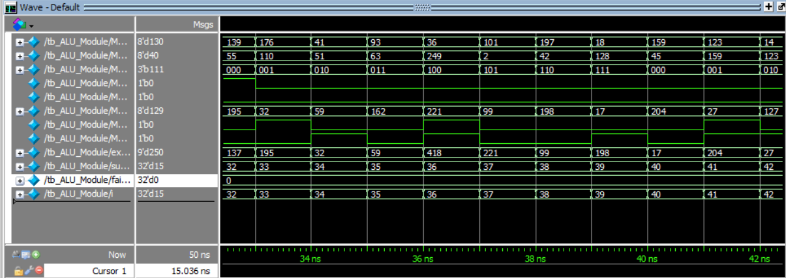

# 8-Bit Kapı Seviyesi (Gate-Level) Verilog ALU Mimarisi

Bu proje, Verilog HDL kullanılarak tamamen **kapı seviyesinde (gate-level)** tasarlanmış ve doğrulanmış modüler bir 8-Bit Aritmetik Mantık Birimidir (ALU). Yüksek güvenilirlikli dijital mantık uygulamaları ve FPGA sentez hedefleri (ör. Intel Cyclone V) için endüstri standartlarına uygun olarak geliştirilmiştir.

---

## 📌 Özellikler

* **Saf Kapı Seviyesi RTL Tasarımı**: Davranışsal (behavioral) operatörler (`+`, `-` vb.) kullanılmadan, tamamen temel mantık kapıları mantığıyla oluşturulmuştur.
* **8 Farklı İşlem (Opcode) Desteği**:
  * `000`: Eldeli Toplama (`ADD` + `Cin`)
  * `001`: Mantıksal VE (`AND`)
  * `010`: Mantıksal VEYA (`OR`)
  * `011`: Mantıksal DEĞİL (`NOT`)
  * `100`: Mantıksal ÖZEL VEYA (`XOR`)
  * `101`: Borçlu Çıkarma (`SUB` - `Bin`)
  * `110`: Artırma (`A + 1`)
  * `111`: Azaltma (`A - 1`)
* **Otomatik Doğrulamalı Testbench**: Kendi içinde barındırdığı "Golden Model" mimarisi sayesinde rastgele girdileri test eder ve sonuçları anlık olarak konsola raporlar.
* **%100 Test Kapsamı**: 1.000'den fazla rastgele test vektörü ile simüle edilmiş ve 0 hata ile doğrulanmıştır.

---

## 📐 Mimari ve Blok Diyagramları

Ana modül olan `ALU_Module.v`, birbirinden bağımsız kapı seviyesindeki alt blokları (tam toplayıcılar, çıkarıcılar, çoklayıcılar ve mantık kapıları) birleştirir.

### Sistem Blok Diyagramı


### Quartus RTL Şeması


---

## 🛠️ Simülasyon ve Doğrulama (Waveform)

Doğrulama süreci, Questa Sim / ModelSim ortamında yazılan özel bir Verilog testbench (`tb_ALU_Module.v`) ile gerçekleştirilmiştir.

* **Rastgele Test Üretimi**: Sinyal girdileri `$urandom_range` fonksiyonu ile dinamik olarak üretilir.
* **Delta-Cycle Senkronizasyonu**: Zamanlama hassasiyeti sayesinde yarış durumları (race condition) ve sinyal kaymaları engellenmiştir.

### Dalga Formu (Simülasyon Çıktısı)


### Konsol Test Sonucu Örneği:
```text
/-----------TEST SONUCLARI---------/
Toplam Test: 1000
Basarili Test: 1000
Basarisiz Test: 0
```

---

## 🚀 Projeyi Çalıştırma

1. Repoyu bilgisayarınıza klonlayın:
   ```bash
   git clone https://github.com/Ayberk-Aktan/ALU_Module.git
   cd ALU_Module
   ```
2. **Questa Sim / ModelSim** veya **Intel Quartus Prime** uygulamasını açın.
3. Tasarımı ve testbench dosyasını derleyin:
   ```bash
   vlog ALU_Module.v tb_ALU_Module.v
   ```
4. Simülasyonu başlatın:
   ```bash
   vsim work.tb_ALU_Module
   run -all
   ```

---

## 🧰 Kullanılan Teknolojiler ve Araçlar

* **Donanım Tanımlama Dili**: Verilog HDL
* **Simülasyon ve EDA Araçları**: Questa Sim / ModelSim, Intel Quartus Prime
* **Hedef Donanım**: Intel Cyclone V FPGA